<div align="center">


**Written from scratch in C++ and drawn on the GPU.**<br>
No Electron, no browser engine: one ~6.5 MB program on Windows and on Linux.

[](https://github.com/maj113/MaiCord/releases/latest)
[](https://github.com/maj113/MaiCord/releases)
[](#requirements)
[](LICENSE)
[](https://github.com/maj113/MaiCord/actions/workflows/ci.yml)

**[<kbd> <br> Download <br> </kbd>](https://github.com/maj113/MaiCord/releases/latest)**
**[<kbd> <br> Install <br> </kbd>](#install)**
**[<kbd> <br> Website <br> </kbd>](https://maicord.com/)**
**[<kbd> <br> Themes, effects and plugins <br> </kbd>](https://maicord.com/plugins/)**

<br>

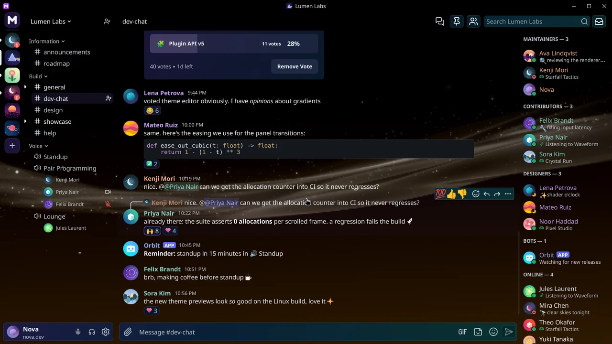

<sub>Every name, message and image on screen is made-up demo content.</sub>

</div>

<!--
  Launch video: GitHub plays a video inline only when it is an upload. Drag introducing-maicord.mp4 (H.264, at most
  10 MB on a free plan) into a new issue or PR comment box, wait for the https://github.com/user-attachments/assets/…
  link, copy it, discard the comment, and replace the line below with that link alone on its own line.
-->
> **Introducing MaiCord**: the launch video is coming soon.

> [!WARNING]
> MaiCord is an **unofficial** third-party client. It is not affiliated with, endorsed by or supported by Discord Inc.
> Using third-party clients may violate [Discord's Terms of Service](https://discord.com/terms) and could put your
> account at risk. Use it at your own discretion. See the [FAQ](#faq).

## Why MaiCord

- **Native.** Freestanding C++23 (no STL, CRT, exceptions or RTTI). MaiCord shapes and rasterizes its own text and
  draws its own interface with Direct3D 11 on Windows and OpenGL ES on Wayland.
- **Small.** One executable of about 6.5 MB on each system, and a download of 5.3 MB on Windows.
- **Quiet.** Nothing redraws while nothing changes: no CPU time measured over 20 s of idle.
- **Yours.** Themes, GPU background effects and native plugins, from a reviewed catalog or your own files.

<details>
<summary><b>Measured numbers</b></summary>

| | Windows | Linux |
| --- | --- | --- |
| Download | 5.3 MB zip, portable | 5.3 MB tarball or 5.9 MB AppImage |
| Executable | one 6.49 MB EXE | one 6.5 MB program |
| On disk | the EXE plus its profile fonts and license notices, ~9 MB together | the same, ~9 MB together |
| Dependencies | only DLLs that ship with Windows | the C library, and what a desktop has: OpenSSL, Wayland, EGL and GLES |
| First frame | ~0.1 s | ~0.7 s (Mesa d3d12) to ~1.0 s (llvmpipe, software) |
| Idle | no CPU time measured over 20 s | the same: 0.00% CPU, under one wakeup a second |
| Memory at the login screen | 54 MB working set | ~165 MB resident, mostly the GPU driver's libraries; the program's own image and heap are ~13 MB |

Measured on one machine (Ryzen 7 5800X, Radeon RX 9070 XT): a Release build on Windows, and the Linux build in WSL2
under headless sway, each on a fresh profile at the signed-out screen, with the idle figures over 20 seconds. Sizes are
the 0.6.6 Windows zip and the Linux 0.6.7 files. Other machines and drivers differ, Linux memory most of all.

</details>

## Features

<table>
  <tr>
    <td width="50%" valign="top">
      <picture>
        <source media="(prefers-color-scheme: light)" srcset=".github/assets/screens/chat-light.webp">
        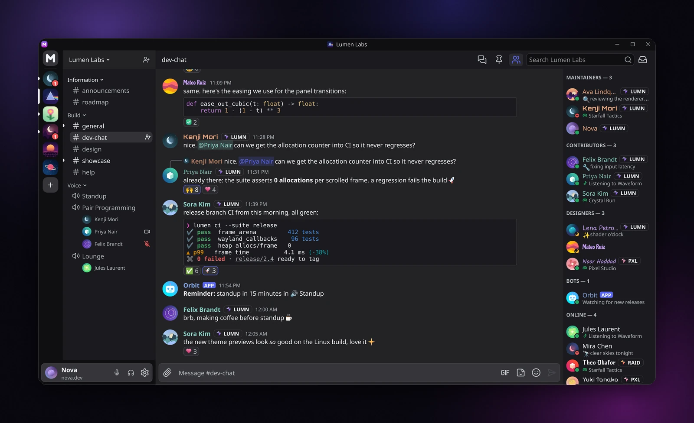
      </picture><br>
      <b>Chat.</b> Markdown, replies, reactions, polls, threads and forums; voice channels show who's in them.
    </td>
    <td width="50%" valign="top">
      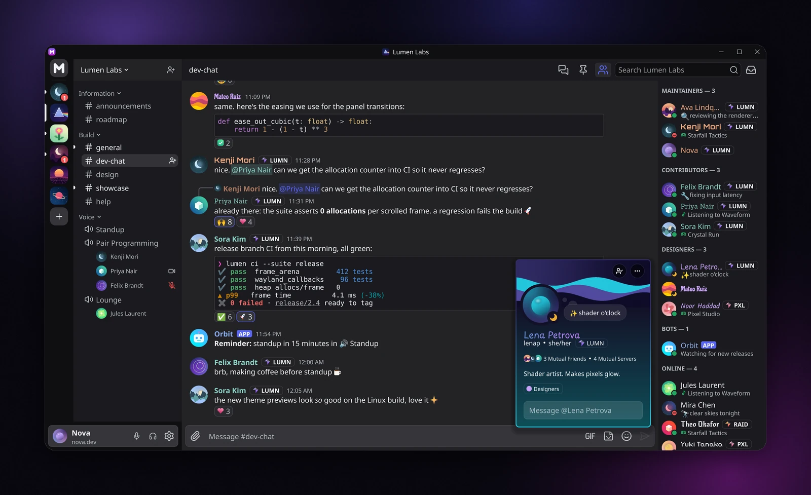<br>
      <b>Profiles.</b> Profile cards with banners, bios and roles; member lists with activities.
    </td>
  </tr>
  <tr>
    <td width="50%" valign="top">
      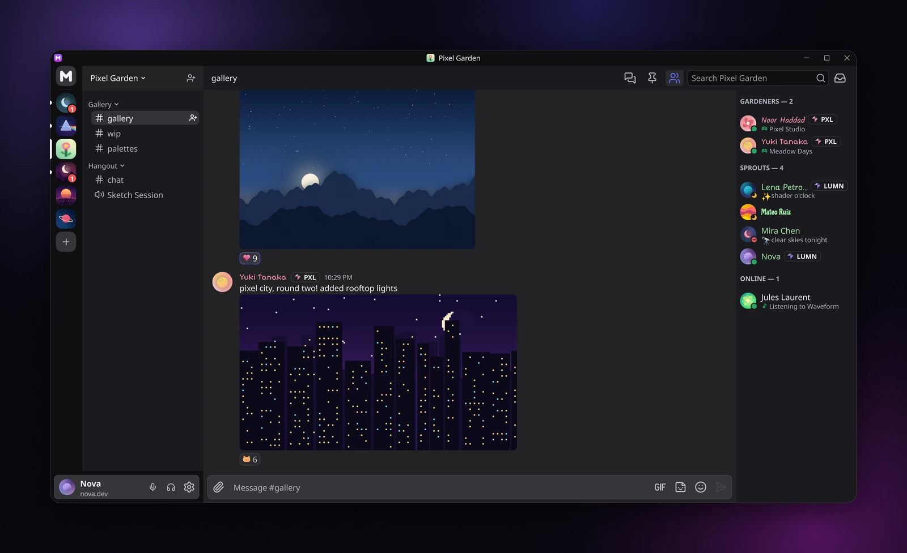<br>
      <b>Servers and media.</b> Image posts, reactions, member activities and unread badges.
    </td>
    <td width="50%" valign="top">
      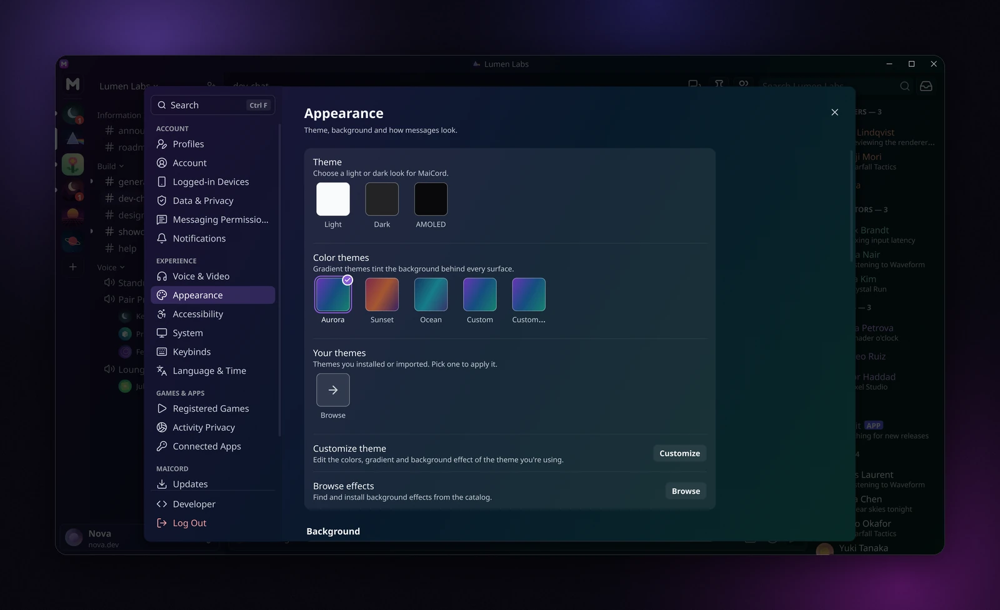<br>
      <b>Appearance.</b> Light, dark and AMOLED bases, gradient themes and a theme editor.
    </td>
  </tr>
  <tr>
    <td width="50%" valign="top">
      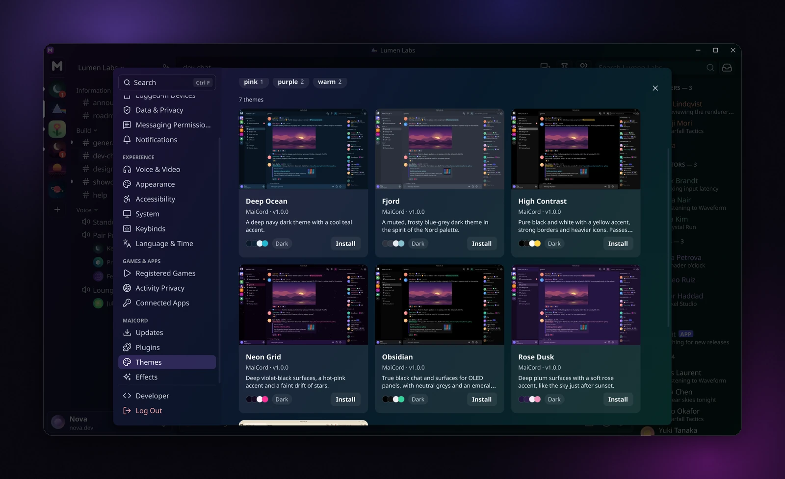<br>
      <b>Themes.</b> Colours, type, spacing and motion; themes can follow the time of day.
    </td>
    <td width="50%" valign="top">
      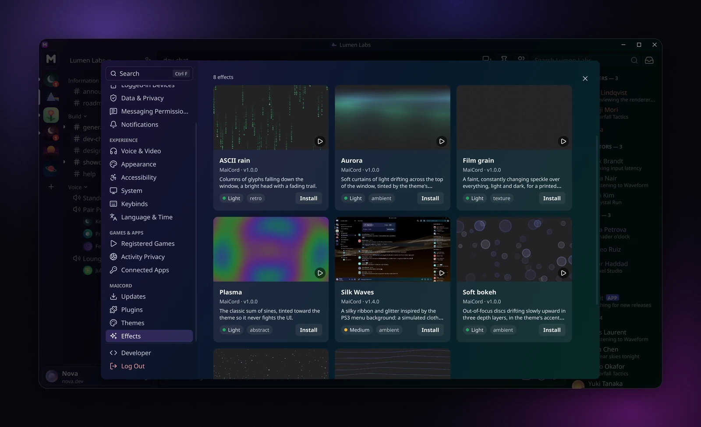<br>
      <b>Background effects.</b> Animated GPU backgrounds behind the whole window.
    </td>
  </tr>
  <tr>
    <td width="50%" valign="top">
      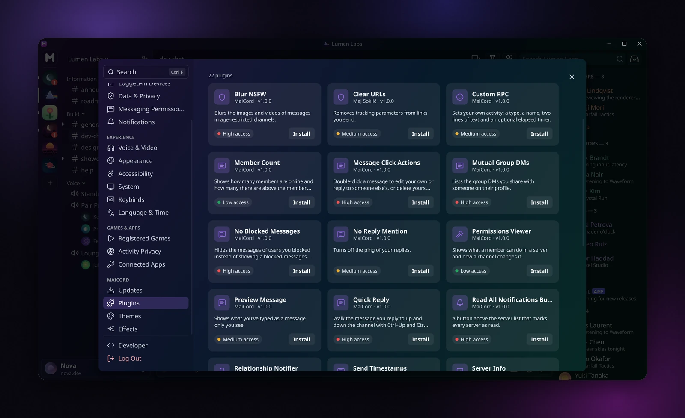<br>
      <b>Plugins.</b> Native plugins from a signed, reviewed catalog; permissions you approve.
    </td>
    <td width="50%" valign="top">
      <b>Voice.</b> End-to-end encrypted voice (DAVE), push-to-talk, soundboard, and watching Go Live streams and cameras.
      <br><br>
      <b>Accounts.</b> Two-factor and QR sign-in, up to five saved accounts.
      <br><br>
      <b>Desktop.</b> Notifications, tray, spellcheck and screen readers on both systems.
      <br><br>
      More under <i>Everything else</i> below.
    </td>
  </tr>
  <tr>
    <td colspan="2" valign="top">
      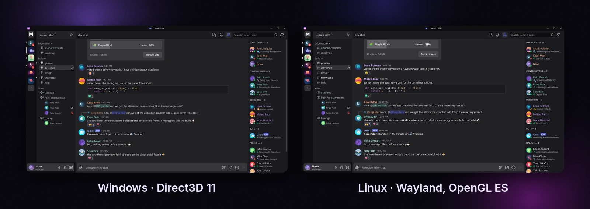<br>
      <b>Windows and Linux.</b> The same client on both: Direct3D 11 on Windows, Wayland and OpenGL ES on Linux.
    </td>
  </tr>
</table>

<details>
<summary><b>Everything else</b></summary>

**Chat**
- Discord markdown, syntax-highlighted code blocks and
  [ANSI colored text](https://gist.github.com/kkrypt0nn/a02506f3712ff2d1c8ca7c9e0aed7c06)
- Rich embeds with image galleries, link previews, stickers and custom emoji
- Replies (with timestamps on the preview), forwards, pins, reactions, threads, forum posts and polls (create and vote)
- Role colors on mentions, in voice participant lists and on typing names
- Slash commands, including Discord's built-in ones, and app buttons, select menus, modals and Components V2 layouts
- Record and send voice messages
- Emoji, GIF and sticker picker that syncs your Discord favorites
- Paste screenshots straight from the clipboard; drag and drop files
- Image zoom: hold <kbd>Ctrl</kbd> over an image in chat, or hold the mouse button on an image in the viewer; scroll for
  the zoom, <kbd>Shift</kbd>+scroll for the lens size
- Search with `from:`, `in:`, `has:`, `mentions:` and `pinned:` filters, an inbox for mentions, and a Quick Switcher on
  <kbd>Ctrl</kbd>+<kbd>K</kbd>

**Voice and video**
- Voice channels with Discord's end-to-end encryption (DAVE)
- Push-to-talk, per-user volume, soundboard and stage channels
- Watch Go Live streams and cameras, decoded on the GPU

**Servers**
- Server settings: roles and permissions, members, bans, audit log, emoji, stickers, soundboard and invites
- Scheduled events, community onboarding, per-server profiles and privacy
- Server folders: opening one closes the others
- Hidden channels are listed with a lock and a summary of who can see them; nothing is fetched from them

**Accounts**
- Password sign-in with two-factor authentication (security keys, Windows Hello on Windows, authenticator apps, backup
  codes, SMS), QR login and CAPTCHA support
- Up to five saved accounts with quick switching
- Full profile editor: avatar cropping, banner, decorations, effects and profile colors

**System integration**
- Native notifications, a tray icon and an unread badge: Windows toasts, the taskbar and the Win32 tray; on Linux the
  desktop portal or D-Bus, a StatusNotifier tray icon and the launcher badge
- Spellcheck and IME input through the Windows text services; Hunspell or Enchant and the Wayland text-input protocol
  on Linux
- Screen reader support through UI Automation on Windows and AT-SPI (Orca) on Linux
- Signed automatic updates from GitHub releases (see [Install](#install) for what updates itself on Linux)

</details>

## Themes, effects and plugins

Browse and install them in **Settings > Themes**, **Settings > Effects** and **Settings > Plugins**, from a
`maicord://` link, or from a file. The catalog is also on the web:
[themes](https://maicord.com/themes/) · [effects](https://maicord.com/effects/) · [plugins](https://maicord.com/plugins/),
with entries from the [MaiCord-plugins](https://github.com/maj113/MaiCord-plugins) repository.

<table>
  <tr>
    <td width="33%" align="center">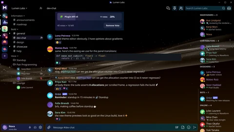<br><b>Silk Waves</b></td>
    <td width="33%" align="center">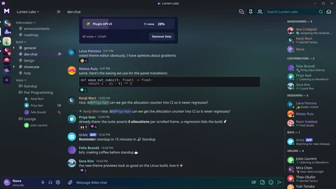<br><b>Aurora</b></td>
    <td width="33%" align="center">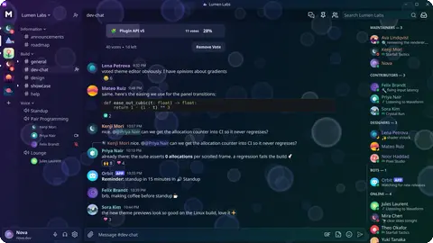<br><b>Soft bokeh</b></td>
  </tr>
  <tr>
    <td width="33%" align="center">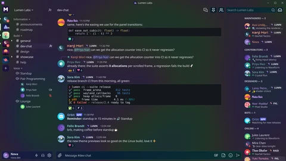<br><b>Plasma</b></td>
    <td width="33%" align="center">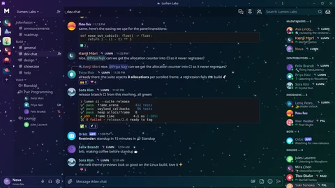<br><b>Starfield</b></td>
    <td width="33%" align="center"><br><b>Wave lines</b></td>
  </tr>
</table>

- **Themes** are JSON files that start from the Dark, Light or AMOLED base and can override any design token, name an
  animated background, and change with the time of day.
- **Background effects** are `.mcfx` packages of shaders and textures: data, not code. MaiCord validates them and caps
  the GPU time an effect may use. One file serves Windows and Linux.
- **Plugins** are native code (a DLL on Windows, a shared object on Linux) with a stable C ABI and a header-only C++
  SDK. Catalog plugins are built by CI from reviewed source and listed in a signed index; you approve each plugin's
  permissions and network hosts before any of its code runs, and they install, update, roll back and toggle without a
  restart. Plugins are native code, so only install ones you trust.
- Anything not from the catalog is marked *not reviewed*, shown with a live preview first, and never updates on its own.

**Make your own:** the [plugin SDK](include/maicord/sdk/README.md), [sample plugins](samples/plugins) and
[sample effects](samples/effects), the [`maicord-plugin`](tools/maicord-plugin) tool (create, build, check and pack;
Developer Mode hot-reloads as you rebuild), and the guides at [maicord.com/plugins/develop](https://maicord.com/plugins/develop/)
and [maicord.com/effects/develop](https://maicord.com/effects/develop/). The theme and effect formats are described in
[CONTRIBUTING.md](CONTRIBUTING.md#themes-effects-and-plugins).

## Install

<details open>
<summary><b>Windows</b></summary>

1. Download `MaiCord-<version>-windows-x64.zip` from the [latest release](https://github.com/maj113/MaiCord/releases/latest).
2. Extract it anywhere you can write to, for example `%LOCALAPPDATA%\Programs\MaiCord`.
3. Run `MaiCord.exe`. No installer or admin rights are needed.

MaiCord keeps its settings and saved sign-ins in `%LOCALAPPDATA%\MaiCord` and updates itself. Every update is checked
against a signature built into the client before it is installed, and it replaces `MaiCord.exe` in place when you
choose *Restart to update*, so the folder must stay writable.

</details>

<details open>
<summary><b>Linux</b></summary>

| You | Do |
| --- | --- |
| Any distribution, one command | `curl -fsSL https://github.com/maj113/MaiCord/releases/latest/download/install.sh \| sh` installs under `~/.local` without root, checks a signature and a SHA-256 before it unpacks anything, and updates itself |
| Any distribution, one file | Download `MaiCord-<version>-x86_64.AppImage` from the [latest release](https://github.com/maj113/MaiCord/releases/latest), `chmod +x` it and run it. `./MaiCord-<version>-x86_64.AppImage --integrate` adds the menu entry and the `discord://` handler |
| Debian, Ubuntu, Mint | `sudo curl -fsSLo /etc/apt/sources.list.d/maicord.sources https://maj113.github.io/MaiCord/repo/maicord.sources && sudo apt update && sudo apt install maicord` |
| Fedora, openSUSE, RHEL-likes | `sudo curl -fsSLo /etc/yum.repos.d/maicord.repo https://maj113.github.io/MaiCord/repo/maicord.repo && sudo dnf install maicord` (openSUSE: `zypper addrepo` the same file) |
| Arch, Manjaro, EndeavourOS | the signed pacman repository below, then `sudo pacman -Syu maicord` |
| NixOS, Nix | `nix run 'github:maj113/MaiCord?dir=packaging/nix'` |
| Alpine, Void (musl) | the `-musl` tarball or AppImage of the release |

```sh
curl -fsSL https://maj113.github.io/MaiCord/repo/maicord.asc | sudo pacman-key --add -
sudo pacman-key --lsign-key 27EFAD9C252F3E39887CA28EACB877AA84964FC8
printf '\n[maicord]\nSigLevel = Required\nServer = https://maj113.github.io/MaiCord/repo/arch/$arch\n' | sudo tee -a /etc/pacman.conf >/dev/null
```

The release also has the `.deb`, `.rpm`, Arch package and tarballs (`maicord-<version>-linux-x86_64.tar.gz`, and
`-musl`) with their checksums. The one-command installer, the tarball install and the glibc AppImage update themselves
from *Settings > Updates*, from the same signed manifests as Windows; a package from a repository is updated by your
package manager, and the musl AppImage by AppImageUpdate. MaiCord keeps its data in `$XDG_DATA_HOME/maicord`
(`~/.local/share/maicord`) for every install. [`packaging/README.md`](packaging/README.md) has every format and its
details.

</details>

### Requirements

<details>
<summary><b>Windows</b>: Windows 10 or 11, 64-bit, and a Direct3D 11 GPU with Tiled Resources Tier 1</summary>

- Windows 10 or 11, 64-bit
- A CPU with AVX and AES-NI
- A GPU with Direct3D 11 (feature level 11_0) and Tiled Resources Tier 1 (Direct3D 11.2); MaiCord refuses to start on a
  GPU or driver without it and says so

</details>

<details>
<summary><b>Linux</b>: x86-64, Linux 6.1+, a Wayland session, glibc 2.34+ or musl</summary>

- x86-64 with AVX and AES-NI, and Linux 6.1 or newer: the network loop runs on io_uring, so a system that disables it
  (`kernel.io_uring_disabled`, Docker's and Podman's default seccomp profile) is refused at startup with the cause named.
  Stock Ubuntu 22.04 and RHEL 9 kernels are older than 6.1
- glibc 2.34 or newer, or musl (Alpine, Void, Chimera). The release is checked in containers of Ubuntu 22.04, Debian 12,
  AlmaLinux 9, Fedora, Arch, NixOS, Alpine, Void and Chimera
- A Wayland compositor: there is no X11 backend. MaiCord draws its own title bar, so it needs no server-side
  decorations. It has been run on sway and Weston
- A GPU driver with OpenGL ES 3.1 over EGL, `GL_EXT_blend_func_extended` and image copies (Mesa, or NVIDIA)
- OpenSSL 3 or 4, libwayland, libxkbcommon and EGL/GLES; used when present: PulseAudio or PipeWire's Pulse server
  (voice), fontconfig, Hunspell or Enchant (spellcheck), libfido2 (security keys), VA-API (video), speech-dispatcher,
  and the desktop portals and a Secret Service (notifications, file dialogs, saved sign-ins)

</details>

## Building from source

**Windows** needs Visual Studio 2026 (or its Build Tools) with *Desktop development with C++*, Python 3.10+ and
Windows PowerShell 5.1; the build fetches its pinned LLVM toolchain on first use.

```powershell
git clone https://github.com/maj113/MaiCord.git
cd MaiCord
powershell.exe -NoProfile -ExecutionPolicy Bypass -File tools\build.ps1
```

**Linux** needs Ubuntu 22.04+, Debian 12+ or similar (WSL2 works) with clang, lld and llvm 23, CMake 3.28+, Ninja,
Python 3, git and rsync; `tools/install_linux_toolchain.sh` installs them on Debian and Ubuntu.

```sh
git clone https://github.com/maj113/MaiCord.git
cd MaiCord
tools/build_linux.sh
```

Add `-Test` (Windows) or `--test` (Linux) to build and run the test suite. Toolchain details, build outputs, tests and
the project layout are in [CONTRIBUTING.md](CONTRIBUTING.md#building-and-testing).

## FAQ

<details>
<summary><b>Is this allowed by Discord?</b></summary>

MaiCord is not made, endorsed or supported by Discord. Discord's [Terms of Service](https://discord.com/terms) (section 9,
*Restrictions on your use of Discord's services*) forbid "using any unauthorized software designed to modify the
services", and Discord has not authorized MaiCord. Using it may violate those terms and could put your account at risk.
It is your choice to make; if your account matters to you, weigh that first.

</details>

<details>
<summary><b>Is my token safe?</b></summary>

Your sign-ins stay on your computer. On Windows they are in `%LOCALAPPDATA%\MaiCord`, encrypted with Windows Data
Protection for your Windows account. On Linux they are in `~/.local/share/maicord`, encrypted with a key held by your
desktop's Secret Service keyring (or a private `0600` key file when there is none). MaiCord sends the token only to
Discord. Plugins get no function that exposes tokens, credentials or cookies, but they are native code, so only install
ones you trust. The code is all here to read, and updates are checked against a signature before they install.

</details>

<details>
<summary><b>Why not Electron?</b></summary>

The official desktop app is a web page running in a bundled browser. MaiCord draws its own interface on the GPU and
only redraws what changes, so it is one small program that starts fast and sits idle without using the CPU. See the
[measured numbers](#why-maicord).

</details>

<details>
<summary><b>Which features are missing?</b></summary>

- Sending camera video and screen share (you can join voice and watch streams and cameras)
- macOS, phones, and X11 on Linux (it needs a Wayland session)
- A Windows installer (the zip is portable)
- More plugin APIs: on-demand Discord fetches and the voice panel
- Other Discord features, tracked in [issues](https://github.com/maj113/MaiCord/issues?q=is%3Aopen+label%3Aparity)

</details>

## Contributing

Bug reports, ideas and pull requests are welcome; please read [CONTRIBUTING.md](CONTRIBUTING.md) first. Report
security problems privately through
[GitHub security advisories](https://github.com/maj113/MaiCord/security/advisories/new).

## License

MaiCord is licensed under the [Mozilla Public License 2.0](LICENSE). Changes to MaiCord's own files must be shared under
the MPL when you distribute them; plugins and themes that only use the public SDK and theme format can use any license.

<details>
<summary>Bundled third-party components</summary>

Release builds include their notices in the `licenses` and `fonts` folders.

| Component | License | Notice |
| --- | --- | --- |
| [Opus](https://opus-codec.org/) 1.6.1 decoder and encoder subsets | BSD-3-Clause | [`third_party/opus/COPYING`](third_party/opus/COPYING) |
| [Lucide](https://lucide.dev/) icons | ISC | [`third_party/lucide/LICENSE`](third_party/lucide/LICENSE) |
| [Twemoji](https://github.com/jdecked/twemoji) flag artwork | CC BY 4.0 | [`assets/licenses/Twemoji-graphics.txt`](assets/licenses/Twemoji-graphics.txt) |
| Unicode data | Unicode License v3 | [`assets/licenses/Unicode-3.0.txt`](assets/licenses/Unicode-3.0.txt) |
| [gemoji](https://github.com/github/gemoji) emoji aliases | MIT | [`assets/licenses/gemoji-MIT.txt`](assets/licenses/gemoji-MIT.txt) |
| [Emojibase](https://emojibase.dev/) shortcodes (incl. JoyPixels and emoji-data presets) | MIT | [`assets/licenses/emojibase-MIT.txt`](assets/licenses/emojibase-MIT.txt) |
| [ICU](https://icu.unicode.org/) 78.3 Thai word list | Unicode License v3 and ICU 1.8.1–57.1 license | [`assets/licenses/ICU-Thai-dictionary.txt`](assets/licenses/ICU-Thai-dictionary.txt) |
| [PyThaiNLP](https://github.com/PyThaiNLP/pythainlp) 5.3.8 Thai word list | CC0 1.0 | [`assets/licenses/PyThaiNLP-corpus.txt`](assets/licenses/PyThaiNLP-corpus.txt) |
| Profile display fonts | SIL Open Font License 1.1 | [`assets/fonts/`](assets/fonts/README.md) |
| MaiCord notification sounds (original) | CC0 1.0 | [`assets/licenses/MaiCord-sounds.txt`](assets/licenses/MaiCord-sounds.txt) |

</details>

## Disclaimer

MaiCord is an independent project and is not affiliated with, authorized by or endorsed by Discord Inc. "Discord" and
related marks are trademarks of Discord Inc. MaiCord is provided "as is", without warranty of any kind.
